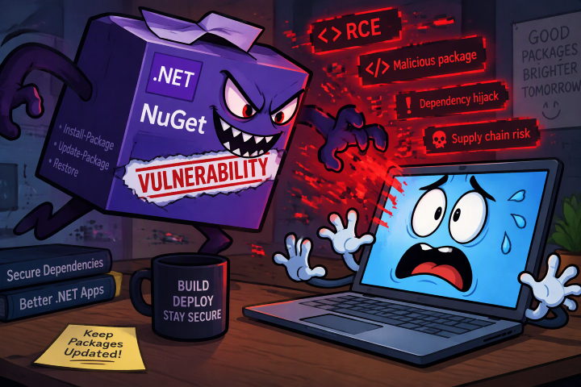

In the age of AI, new zero-day vulnerabilities are showing up every day, and .NET NuGet packages are no exception.

Typically, package vulnerabilities are detected and taken down within the first couple days of hitting a package registry.
However, if you (or one of your team members) had done a NuGet update on the same day as a vulnerability was released, your machine could end up compromised, or you may end up unknowingly shipping malicious code.

## .NET 11 to the rescue

.NET 11 introduces a new security feature that will not update NuGet packages to a new version until the version has been published for at least X number of hours.

To take advantage of this, simply add the `minPublishAgeHours` element to your `NuGet.config` file's package source.
For example, if you want to ensure you do not update to any NuGet package versions from nuget.org that have been published for less than 3 days (72 hours), you might configure your `NuGet.config` like this:

```xml
<?xml version="1.0" encoding="utf-8"?>
<configuration>
  <packageSources>
    <add key="nuget.org" value="https://api.nuget.org/v3/index.json" minPublishAgeHours="72" />
  </packageSources>
</configuration>
```

If you have multiple package sources, you may want to add the `minPublishAgeHours` attribute to each of them.

72 hours not feel like long enough?
Set it to a week (168 hours) or whatever duration you feel comfortable with.

If you don't want to manually create or update your `NuGet.config` file, you can use the `dotnet` CLI to set the `minPublishAgeHours` for your package sources.
For example:

```bash
dotnet nuget add source https://api.nuget.org/v3/index.json --name nuget.org --min-publish-age-hours 72
```

Or to update an existing source, you can use:

```bash
dotnet nuget update source nuget.org --min-publish-age-hours 72
```

See [the official docs here](https://learn.microsoft.com/es-es/nuget/consume-packages/minimum-package-publish-age).

Your projects aren't on .NET 11 yet?
Don't worry.
You can still add the `minPublishAgeHours` setting to your `NuGet.config` file, and it will simply be ignored by older versions of the .NET SDK that do not support it.
But when you do eventually update, it will take effect and help protect your systems.

## Conclusion

That's it!
By using this simple configuration you can keep your machine, your teammates machines, your build servers, and your applications safer from zero-day NuGet vulnerabilities.

## Afterthoughts

Since the `NuGet.config` file is typically configured at the solution or git repo level, consider writing a script to rip through all of your repos and add/update the `NuGet.config` file with the `minPublishAgeHours` setting for your package sources.
Or ask AI to create you a script to do it 😉.

Aaaaaaaand here's a creepy image to help remind you to keep your packages up to date, but not too up to date 😁

Happy coding!


